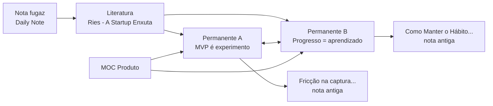

> [!summary] Em uma frase
> Um caso real do funil inteiro, do começo ao fim: um trecho de *A Startup Enxuta* vira nota fugaz, depois nota de literatura, depois **duas** notas permanentes conectadas a notas que já existem, e por fim entra num MOC. Use como modelo na primeira vez que for processar algo.

## Etapa 1: nota fugaz (na Daily Note, 30 segundos)
Lendo no Kindle, você anota na Daily Note do dia:
```markdown
## Captura
- startup enxuta: MVP não é produto pequeno, é experimento. lembra o
  que faço com feature flags no trabalho? #processar
```
Sem formatação, sem pensar muito. O `#processar` marca para a rotina diária. Ver [[Notas Fugazes (Fleeting Notes)]].

## Etapa 2: nota de literatura (na revisão, 10 min)
Com o livro (ou os highlights do Kindle) aberto, você escreve **com suas palavras** o que o autor diz, ainda preso à fonte. Template: `Templates/Zettelkasten/Zettelkasten - Literature Note.md`.
```markdown
---
title: "Ries - A Startup Enxuta"
tags:
  - Zettelkasten/Literature
source: "[[A startup enxuta - Eric Ries]]"
---
- Ries define MVP como a versão que permite completar **um ciclo de
  construir-medir-aprender** com o menor esforço. (cap. 6)
- O objetivo do MVP é **testar uma hipótese**, não lançar o produto.
- "Aprendizado validado" é a unidade de progresso, não features entregues.
- Ele critica times que medem progresso por quantidade de código.
```
Ver [[Notas de Literatura (Literature Notes)]].

## Etapa 3: notas permanentes (o trabalho de verdade, 20 min)
**Feche o livro.** Pergunte: quais ideias aqui valem para além deste livro? Saem duas.

### Permanente A
```markdown
---
title: "Um MVP é um experimento, não uma versão menor do produto"
tags:
  - Zettelkasten/Product
---
Tratar o MVP como "produto com menos funcionalidades" leva a polir coisas
que talvez ninguém queira. O MVP existe para responder **uma pergunta**
(alguém quer isso? alguém paga?) com o menor custo possível. Se ele não
testa uma hipótese clara, é só um produto incompleto.

Na prática, uma feature flag ligada para 5% dos usuários é um MVP: o
objetivo é aprender, não entregar.

Fonte: Ries, *A Startup Enxuta*, cap. 6.

## Ver também
- [[Progresso se mede pelo que se aprende, não pelo que se entrega]] — a
  métrica que dá sentido ao MVP
- [[Fricção na captura elimina ideias antes de serem avaliadas]] — mesma
  lógica aplicada a notas: testar barato antes de investir
```

### Permanente B
```markdown
---
title: "Progresso se mede pelo que se aprende, não pelo que se entrega"
tags:
  - Zettelkasten/Product
---
Contar features entregues ou linhas de código mede **atividade**. Se o
que foi entregue não confirmou nem derrubou nenhuma hipótese, a equipe
se moveu sem avançar.

Isso vale também para estudo: terminar 10 aulas de um curso sem conseguir
explicar nenhuma é atividade, não aprendizado.

Fonte: Ries, *A Startup Enxuta* (aprendizado validado).

## Ver também
- [[Um MVP é um experimento, não uma versão menor do produto]] — a
  ferramenta prática dessa métrica
- [[Como Manter o Hábito a Longo Prazo]] — métricas de vaidade também
  aparecem no Zettelkasten (contar notas em vez de conexões)
```

Repare:
- **Títulos são afirmações**, não rótulos ("MVP" seria um rótulo ruim).
- A segunda nota **saiu do contexto do livro**: aplica a ideia a estudo.
- Cada link tem **uma frase de por quê**.
- As duas notas linkam **uma à outra** e a notas **antigas** do vault.

Checklist completo em [[Como Escrever uma Boa Nota Permanente]].

## Etapa 4: MOC (só quando o cluster existir)
Depois de algumas semanas, você tem 6 notas sobre produto e experimentação. Aí sim cria (ou atualiza) um MOC:
```markdown
# Produto e Experimentação MOC
## O que é experimento
- [[Um MVP é um experimento, não uma versão menor do produto]]
## Como medir
- [[Progresso se mede pelo que se aprende, não pelo que se entrega]]
## Tensões
- Experimento rápido vs. qualidade de código: onde fica o limite?
```
Ver [[Notas Estruturais e MOCs]].

## O resultado em forma de rede



## Ver também
- [[Exemplo - Das Notas a um Texto Pronto]]: o próximo passo, usar essas notas para escrever
- [[Fluxo de Captura - Da Ideia à Nota Permanente]]
- [[Sumarização Progressiva]]: o caminho alternativo do BASB para o mesmo livro
