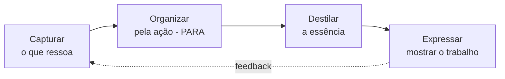

> [!info] Contexto desta nota
> Copiada do vault `SecondBrainObsidian` em 2026-11-02. Onde aparecem "este vault" e caminhos como `1 - Projects/`, a nota descreve aquele vault, não este.

> [!summary] Em uma frase
> CODE é o caminho que a informação percorre no segundo cérebro: **Capturar** o que ressoa, **Organizar** pela ação, **Destilar** até a essência e **Expressar** em algo concreto. Cada etapa tem uma pergunta que ela responde.

## O fluxo

## Etapa por etapa

| Etapa | Pergunta | Ação concreta | Erro comum |
|---|---|---|---|
| **Capturar** | "Isso ressoa comigo?" | Guardar só o trecho essencial, com a fonte | Guardar artigo inteiro "por via das dúvidas" |
| **Organizar** | "Em que projeto isso será útil?" | Colocar na pasta PARA certa | Criar pastas por assunto |
| **Destilar** | "Qual é o ponto principal?" | Negrito, destaque, resumo (em camadas) | Destilar tudo na hora da captura |
| **Expressar** | "O que posso criar com isso?" | Usar notas em projetos reais | Acumular sem nunca usar |

## C, Capturar
- **Fontes típicas:** highlights de livros (Kindle), artigos (Web Clipper), cursos, podcasts, ideias próprias, conversas, fotos.
- **Regra:** capture **pouco e bem**. Uma nota com 3 trechos certeiros vale mais que um PDF de 40 páginas.
- **Neste vault:** `3 - Resources/Clippings/` (Web Clipper), `3 - Resources/Library and Highlights/` (Kindle), a Daily Note em `0 - Inbox/` (ideias soltas).

## O, Organizar
- Use [[PARA]]. A decisão leva **segundos**, não minutos. Se demorar, jogue em Recursos e siga.
- Organizar **não é** fazer taxonomia perfeita. É deixar a nota perto de onde ela será usada.

## D, Destilar
- Use a [[Sumarização Progressiva]].
- Destile **oportunamente**: só quando for usar a nota de novo. Nunca no momento da captura.

## E, Expressar
- Use [[Pacotes Intermediários e Expressão|pacotes intermediários]]: monte entregas a partir de peças prontas.
- A expressão volta como captura: o que você produz (um post, um código, uma aula) também vira material.

## Exemplo completo (um ciclo real)
> [!example] Do highlight ao post no LinkedIn
> 1. **Capturar:** lendo *A Startup Enxuta* no Kindle, você grifa "o único jeito de vencer é aprender mais rápido que todo mundo". O plugin do Kindle traz o grifo para `Library and Highlights/Highlight Summaries/Kindle/`.
> 2. **Organizar:** você tem um projeto ativo "Post LinkedIn sobre MVP". O grifo vai linkado na nota desse projeto (ou a nota do livro fica em Recursos e o projeto linka para ela).
> 3. **Destilar:** quando abre a nota para escrever, você deixa em **negrito** as 3 frases mais fortes e escreve um resumo de 2 linhas no topo.
> 4. **Expressar:** escreve o post usando essas 3 frases como esqueleto. O post publicado volta para o vault (em `IA/Prompts/` ou no Arquivo) como pacote intermediário reaproveitável.

## Ver também
- [[O que é Building a Second Brain]]
- [[Fluxo de Captura - Da Ideia à Nota Permanente]]: o funil equivalente no Zettelkasten (mais lento e mais profundo)
- [[As 5 Etapas do GTD]]: CODE é para informação; o GTD é para ações. Os dois começam com "capturar".
