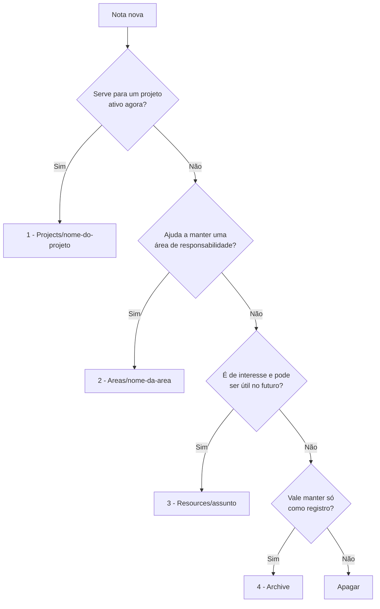

> [!info] Contexto desta nota
> Copiada do vault `SecondBrainObsidian` em 2026-11-02. Onde aparecem "este vault" e caminhos como `1 - Projects/`, a nota descreve aquele vault, não este.

> [!summary] Em uma frase
> Faça as perguntas **em ordem**, da mais para a menos acionável, e pare na primeira resposta "sim". Se levar mais de 30 segundos, jogue em Recursos e siga.

## A árvore de decisão

## Exemplos resolvidos
| Nota | Resposta | Por quê |
|---|---|---|
| Descrição da vaga da Stripe | **Projeto** "Candidatura Stripe" | Tem prazo, termina |
| Planilha de gastos de outubro | **Área** "Finanças" | Responsabilidade contínua |
| Highlight de *A Arte da Guerra* | **Recurso** "Livros" | Interesse, sem compromisso |
| Notas do curso de Docker (concluído) | **Recurso** "Docker" | Ainda serve de referência |
| Roteiro de vídeo já publicado | **Arquivo** | Projeto encerrado |
| Lição da Escola Sabatina desta semana | **Área** "Vida espiritual" | Hábito contínuo |
| Curso Livewire v3 que você está fazendo agora, com meta de terminar no mês | **Projeto** | Tem prazo e fim |
| O mesmo curso, sem meta de terminar | **Recurso** | Sem prazo, é consulta |

## Quando a mesma nota serve para 2 lugares
Não duplique. No Obsidian você tem duas opções:
1. Coloque a nota onde ela é **mais acionável** e **linke** do outro lugar.
2. Deixe em Recursos e, na nota do projeto, liste os links para ela.

A opção 2 é a mais comum no Obsidian, porque links são baratos e pastas não.

## Ver também
- [[As 4 Categorias - Projetos Áreas Recursos Arquivo]]
- [[Fluxograma de Processamento da Inbox]]: a árvore equivalente no GTD, para **ações**
