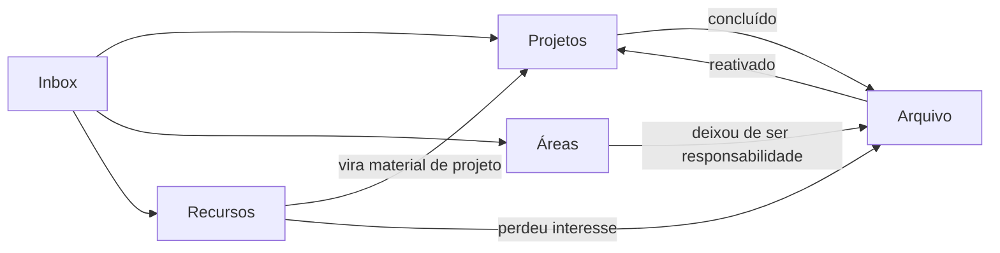

> [!summary] Em uma frase
> PARA não é uma estrutura fixa, é um **fluxo**: as notas entram pela Inbox, sobem para Projetos quando ficam ativas e descem para o Arquivo quando terminam. A revisão é o que faz esse fluxo acontecer.

## O fluxo entre as pastas

## Movimentos típicos
| Movimento | Quando | Exemplo |
|---|---|---|
| Recurso → Projeto | Começou a usar | Notas de Livewire viram base do projeto "CRM" |
| Projeto → Arquivo | Terminou | Vídeo publicado |
| Projeto → Recurso | O resultado serve de referência | Setup de Docker que você documentou |
| Área → Arquivo | Mudou de vida | Emprego antigo |
| Arquivo → Projeto | Retomou | Curso pausado retomado |

## Ritmo de manutenção
- **Na hora (segundos):** ao capturar, decida a pasta; se não souber, Inbox.
- **Semanal (10 min dentro da revisão semanal):** zerar a Inbox; conferir se a lista de projetos ativos está correta.
- **Mensal:** arquivar projetos concluídos; revisar áreas; apagar pastas vazias.
- **Ao concluir um projeto:** checklist de fim de projeto (ver [[Hábitos e Revisões do BASB]]).

> [!tip] Regra do "just-in-time"
> Não reorganize pastas "por organizar". Só mexa quando um projeto pedir. Reorganização preventiva é procrastinação disfarçada.

## Ver também
- [[Rotina Integrada - Diária Semanal Mensal]]
- [[Revisão Semanal do GTD]]
