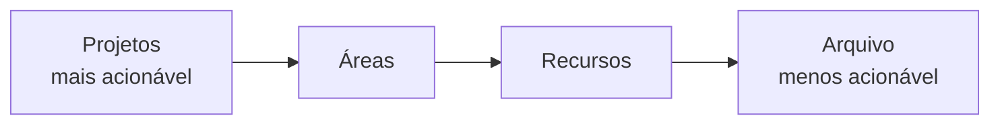

> [!summary] Em uma frase
> PARA organiza **toda** a informação digital (notas, arquivos, e-mails, documentos) em 4 categorias, das mais para as menos acionáveis: **P**rojetos, **Á**reas, **R**ecursos e **A**rquivo. A pergunta não é "sobre o que é isso?", e sim "**para que vou usar isso?**".

## A ideia central: acionabilidade

- **Projetos** você está fazendo **agora**, com prazo.
- **Áreas** você mantém **sempre**, sem prazo.
- **Recursos** podem ser úteis **algum dia**.
- **Arquivo** é o que **não está mais ativo**.

## Por que não organizar por assunto
A organização por assunto (`Programação/`, `Bíblia/`, `Carreira/`) parece natural porque é como bibliotecas funcionam. O problema:
- Uma biblioteca é feita para **guardar** para muita gente. Seu segundo cérebro é feito para **usar** por uma pessoa.
- Um projeto real ("conseguir vaga na Stripe") puxa material de vários assuntos (inglês, Laravel, currículo). Por assunto, ele fica espalhado em 5 pastas.
- Pastas por assunto crescem para sempre e ninguém arquiva nada.

## Características do PARA
- **Universal:** a mesma estrutura de 4 pastas no Obsidian, no Google Drive, nos downloads, no e-mail. Você não precisa aprender um sistema por ferramenta.
- **Fluido:** as coisas **mudam de pasta**. Um recurso vira material de projeto; um projeto concluído vai para o arquivo; uma área abandonada também.
- **Raso:** no máximo 2 ou 3 níveis de pasta. Profundidade é sinal de taxonomia excessiva.
- **Rápido:** decidir onde algo vai deve levar segundos.

## Onde o PARA é fraco (e o que complementa)
| Fraqueza | Complemento |
|---|---|
| Não gera conexões entre ideias | [[Zettelkasten Method]] dentro de Recursos |
| Não diz o que fazer em seguida | [[GTD]] para próximas ações |
| Pastas escondem notas de outros projetos | Links e MOCs ([[LYT]]) |

## Ver também
- [[As 4 Categorias - Projetos Áreas Recursos Arquivo]]
- [[Zettelkasten vs PARA vs GTD vs Notion]]
