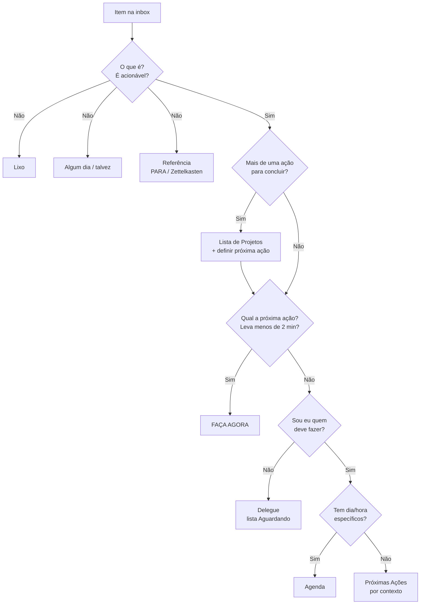

> [!summary] Em uma frase
> O fluxograma do GTD transforma cada item da inbox numa **decisão**: lixo, referência, algum dia, faça agora, delegue ou agende. Nada volta para a inbox.

## O fluxograma

## As regras do processamento
1. **De cima para baixo**, um item por vez. Não escolha o mais fácil primeiro.
2. **Nada volta para a inbox.** Cada item sai com uma decisão.
3. **Regra dos 2 minutos:** se fazer leva menos que organizar, faça.
4. Se o item é **informação** (não ação), ele sai do GTD e vai para o [[PARA]] ou para o [[Zettelkasten Method]]. Aqui os sistemas se encontram.

## Exemplos de decisões
| Item | Decisão |
|---|---|
| "Responder e-mail do recrutador" (1 min) | Faça agora |
| "Ideia: vídeo sobre Xdebug" | Algum dia/talvez (ou projeto, se for fazer este mês) |
| "Highlight de A Arte da Guerra" | Referência → Recursos/Livros |
| "Pedir pro colega revisar o PR" | Delegue → Aguardando |
| "Dentista terça 14h" | Agenda |
| "Configurar CI do projeto pessoal" | Próximas ações `@computador` |
| "Insight: atomicidade vale para funções também" | Referência → nota fugaz do Zettelkasten |

## Ver também
- [[As 5 Etapas do GTD]]
- [[Como Decidir Onde uma Nota Vai]]: a árvore do PARA, que entra no galho "Referência"
- [[Notas Fugazes (Fleeting Notes)]]: o galho "insight" vai para o Zettelkasten
