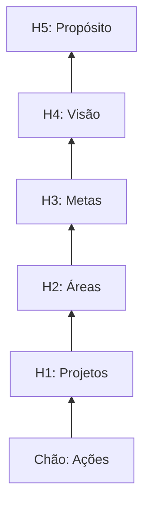

> [!info] Contexto desta nota
> Copiada do vault `SecondBrainObsidian` em 2026-11-02. Onde aparecem "este vault" e caminhos como `1 - Projects/`, a nota descreve aquele vault, não este.

> [!summary] Em uma frase
> O GTD não é só lista de tarefas: ele tem **6 níveis de altitude**, das ações de hoje até o propósito de vida. As ações do dia a dia ganham sentido quando estão ligadas aos níveis de cima.

## Os 6 horizontes

| Nível | Nome | Pergunta | Revisão | Exemplo |
|---|---|---|---|---|
| **Chão** | Ações | O que faço agora? | Diária | Reescrever resumo do currículo |
| **H1** | Projetos | O que quero concluir em breve? | Semanal | Candidatura Stripe |
| **H2** | Áreas de foco | O que preciso manter? | Mensal | Carreira, saúde, família, fé |
| **H3** | Metas (1 a 2 anos) | O que quero alcançar? | Trimestral | Trabalhar remoto para empresa internacional |
| **H4** | Visão (3 a 5 anos) | Como seria o sucesso? | Anual | Ser referência técnica e ensinar no YouTube |
| **H5** | Propósito e princípios | Por que eu existo? | Anual | Valores, fé, missão pessoal |

## Correspondência com PARA
- H1 Projetos = `1 - Projects`
- H2 Áreas = `2 - Areas`
- H3 a H5 podem ser **uma nota cada** dentro de uma área pessoal (ex.: `2 - Areas/Pessoal/Visão e Metas.md`).

## Modelo de planejamento natural
Para projetos grandes, o GTD sugere pensar nesta ordem (é como o cérebro planeja naturalmente):
1. **Propósito e princípios:** por que fazer isso?
2. **Visão do resultado:** como fica quando estiver pronto?
3. **Brainstorm:** todas as ideias, sem filtro.
4. **Organizar:** agrupar, ordenar, priorizar.
5. **Próximas ações:** qual o primeiro passo físico?

Esse modelo cabe bem no começo de uma nota de projeto.

## Ver também
- [[Os 12 Problemas Favoritos]]: um primo do H3/H4, focado em perguntas
- [[Listas, Contextos e Próximas Ações]]
