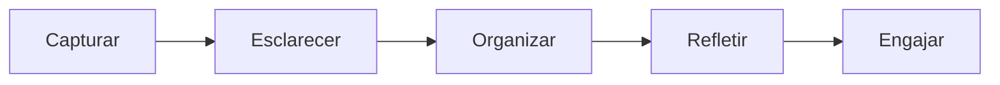

> [!info] Contexto desta nota
> Copiada do vault `SecondBrainObsidian` em 2026-11-02. Onde aparecem "este vault" e caminhos como `1 - Projects/`, a nota descreve aquele vault, não este.

> [!summary] Em uma frase
> GTD parte de uma observação simples: **sua mente é para ter ideias, não para guardá-las**. Tudo que te ocupa a cabeça ("open loops") vai para um sistema confiável, e cada item ganha uma **próxima ação física e concreta**.

## O problema: "loops abertos"
Cada compromisso não resolvido ("tenho que ligar pro dentista", "preciso ver aquele bug", "comprar presente") ocupa espaço mental. A mente fica lembrando na hora errada (no banho, às 3 da manhã) e esquece na hora certa. Resultado: ansiedade e sensação de estar sempre devendo.

## A solução: "mente como água"
Allen usa a imagem de uma água parada: reage na medida certa ao que cai nela e depois volta ao normal. Com tudo capturado e decidido, você reage ao que importa sem ruído de fundo.

## Os dois conceitos-chave
1. **Próxima ação:** a próxima atividade **física e visível** que faz algo andar. Não "resolver o currículo", e sim "abrir o currículo e reescrever o resumo do topo".
2. **Resultado desejado (projeto):** o que significa "feito". Qualquer coisa que exige **mais de uma ação** e pode ser concluída em até ~1 ano é um projeto no GTD.

## As 5 etapas (resumo)

Detalhes em [[As 5 Etapas do GTD]].

## O papel do GTD num segundo cérebro
| Camada | Método | Pergunta |
|---|---|---|
| **Ação** | GTD | O que faço agora? |
| **Organização** | [[PARA]] | Onde está o material desse projeto? |
| **Pensamento** | [[Zettelkasten Method]] | O que eu penso sobre isso? |

GTD e PARA compartilham a ideia de **projeto** (resultado com fim). Isso faz deles uma dupla natural: a lista de projetos do GTD = a pasta `1 - Projects` do PARA.

> [!important] O que o GTD não é
> Não é sistema de conhecimento. Notas de estudo, highlights e ideias **não** entram nas listas do GTD. A lista "Referência" do GTD é exatamente o lugar que o PARA e o Zettelkasten cuidam muito melhor.

## Ver também
- [[As 5 Etapas do GTD]]
- [[Zettelkasten vs PARA vs GTD vs Notion]]
