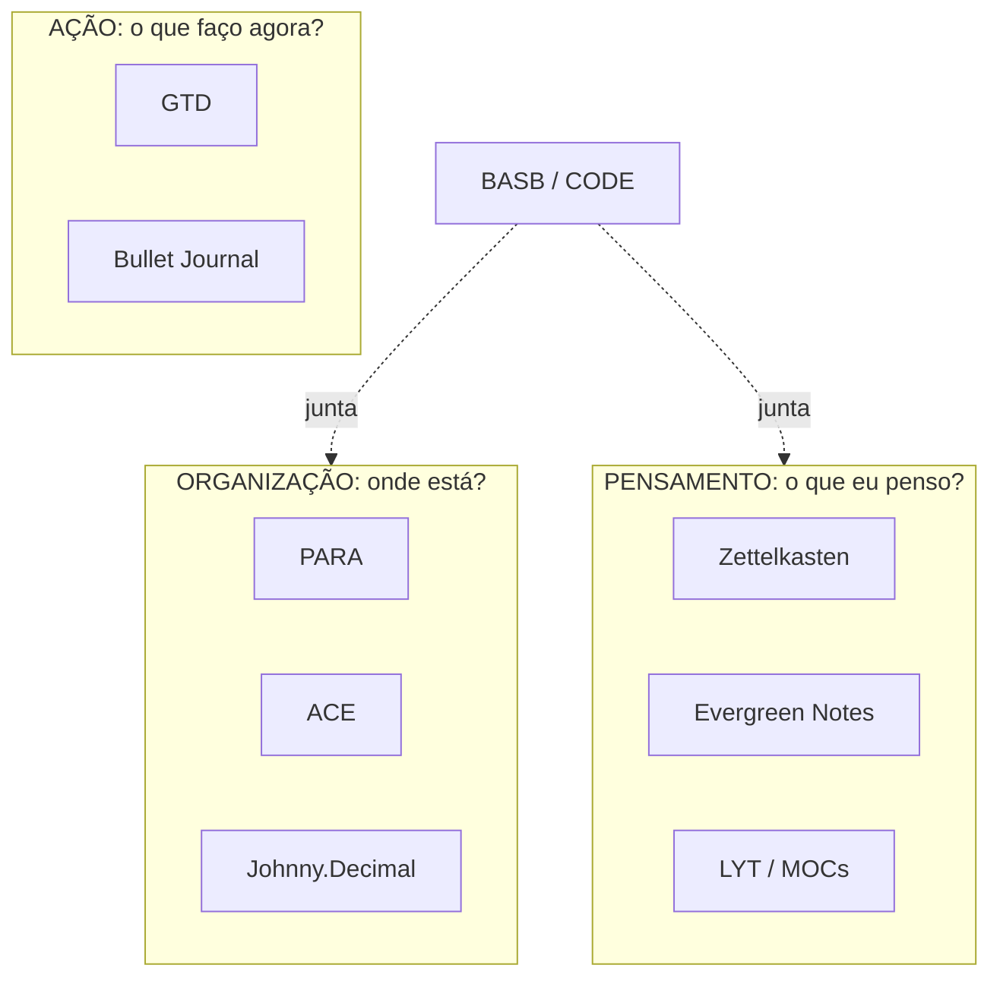

> [!summary] Em uma frase
> Os métodos se dividem em **3 camadas**: **ação** (GTD, Bullet Journal), **organização** (PARA, ACE, Johnny.Decimal) e **pensamento** (Zettelkasten, Evergreen Notes, LYT). O BASB é um "guarda-chuva" que junta organização e expressão. Escolher bem é escolher **um por camada**, não um para tudo.

## As 3 camadas

## Tabela geral

| Método | Autor | Camada | Unidade | Organiza por | Esforço para manter | Melhor para |
|---|---|---|---|---|---|---|
| [[Zettelkasten Method]] | Niklas Luhmann | Pensamento | Nota atômica | Links | Alto | Escrever, pesquisar, ideias originais |
| [[Evergreen Notes]] | Andy Matuschak | Pensamento | Nota atômica | Links | Alto | Pensamento de longo prazo |
| [[LYT]] | Nick Milo | Pensamento + Org. | Nota + MOC | MOCs | Médio | Estudar e explorar no Obsidian |
| [[BASB]] | Tiago Forte | Org. + Expressão | Nota/documento | Ação (PARA) | Baixo a médio | Produzir com o que consome |
| [[PARA]] | Tiago Forte | Organização | Pasta/documento | Acionabilidade | Baixo | Projetos com entrega |
| [[ACE - Atlas Calendar Efforts\|ACE]] | Nick Milo | Organização | Pasta | Espaço/tempo/ação | Baixo | Vault de estudo |
| [[Johnny Decimal]] | Johnny Noble | Organização | Arquivo | Número | Baixo | Documentos, arquivos |
| [[GTD]] | David Allen | Ação | Tarefa | Contexto | Médio | Muitas responsabilidades |
| [[Bullet Journal]] | Ryder Carroll | Ação | Linha de registro | Tempo | Baixo | Rotina diária, papel |
| [[Notion - Ferramenta vs Método\|Notion]] | — | Ferramenta | — | O que você montar | — | Equipe, dados estruturados |

## Comparação pelos critérios que importam
| Critério | Zettelkasten | PARA/BASB | GTD | LYT/ACE |
|---|---|---|---|---|
| Ajuda a **ter ideias novas** | ⭐⭐⭐ | ⭐ | — | ⭐⭐ |
| Ajuda a **achar coisas rápido** | ⭐⭐ | ⭐⭐⭐ | ⭐ | ⭐⭐ |
| Ajuda a **entregar projetos** | ⭐ | ⭐⭐⭐ | ⭐⭐⭐ | ⭐⭐ |
| Ajuda a **reduzir ansiedade** | — | ⭐ | ⭐⭐⭐ | ⭐ |
| **Curva de aprendizado** | Íngreme | Suave | Média | Suave |
| **Tempo até dar retorno** | Meses | Dias | Semanas | Semanas |
| Funciona **fora do Obsidian** | Sim | Sim (qualquer app) | Sim | Pouco |

## O que todos têm em comum
Todos os métodos sérios repetem o mesmo ciclo com nomes diferentes:

| Etapa | Zettelkasten | BASB | GTD | LYT |
|---|---|---|---|---|
| Entrar | Nota fugaz | Capturar | Capturar | Add |
| Processar | Literatura → permanente | Organizar + Destilar | Esclarecer + Organizar | Relate |
| Revisar | Revisão semanal | Revisão semanal | Revisão semanal | — |
| Usar | Escrever a partir das notas | Expressar | Engajar | Communicate |

**Conclusão:** o que faz um segundo cérebro funcionar é **capturar sempre, processar com frequência, revisar toda semana e usar o que guardou**. O método só define os detalhes.

## Ver também
- [[Qual Método Escolher - Árvore de Decisão]]
- [[Zettelkasten vs PARA vs GTD vs Notion]]: a primeira comparação, na pasta do Zettelkasten
