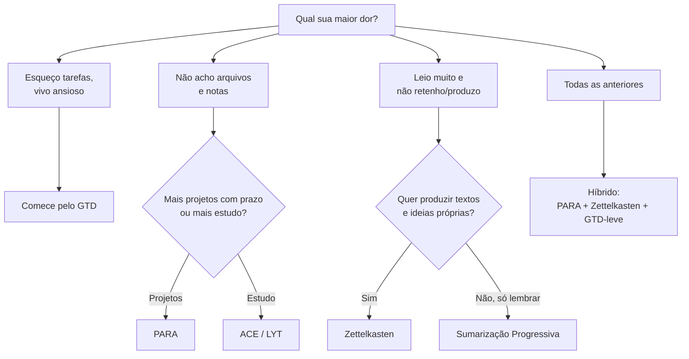

> [!summary] Em uma frase
> Escolha pela **dor principal**: se a dor é "esqueço o que fazer", GTD; se é "não acho minhas coisas", PARA; se é "não consigo pensar/escrever sobre o que leio", Zettelkasten. A maioria das pessoas tem as três dores, por isso o híbrido.

## Árvore de decisão

## Por perfil
| Perfil | Recomendação | Por quê |
|---|---|---|
| **Dev que estuda muito e quer mudar de emprego** | Híbrido PARA + Zettelkasten + GTD-leve | Tem projetos (vagas, cursos), estudo profundo e muitas tarefas |
| Estudante / pesquisador | Zettelkasten + ACE | Pouca entrega com prazo, muito pensamento |
| Gestor com muitas reuniões | GTD + PARA | Ação e arquivos dominam |
| Criador de conteúdo | BASB completo (PARA + CODE) + Zettelkasten leve | Precisa expressar com frequência |
| Quem está começando do zero | Só **PARA + Daily Note** por 1 mês | Simples; o resto vem depois |

## Regras gerais
1. **Um método por camada.** Não use PARA e ACE ao mesmo tempo, nem GTD e Bullet Journal completos.
2. **Comece por uma camada só**, a da maior dor. Adicione outra quando a primeira virar hábito (2 a 4 semanas).
3. **Simplifique antes de complicar.** Se uma regra do método não te ajuda, corte.
4. **A ferramenta é a última decisão.** Você já tem Obsidian; está decidido.

## Ver também
- [[Setup Recomendado - O Híbrido PARA + Zettelkasten + GTD]]
- [[Comparativo Completo dos Métodos]]
