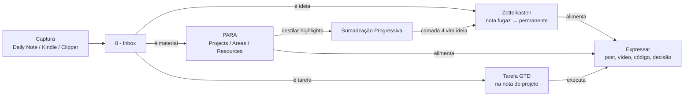

> [!info] Contexto desta nota
> Copiada do vault `SecondBrainObsidian` em 2026-11-02. Onde aparecem "este vault" e caminhos como `1 - Projects/`, a nota descreve aquele vault, não este.

> [!summary] A escolha
> ✅ **Aplicado neste vault em 2026-10-13.** **PARA** para as pastas (onde as coisas ficam), **Zettelkasten** para as ideias (o que eu penso), **GTD-leve** para as tarefas (o que faço agora) e **Sumarização Progressiva** para os livros e highlights. Cada método faz só o que faz melhor, e uma revisão semanal única amarra tudo.

## Por que essa combinação (e não um método só)
| Necessidade deste vault | Quem resolve | Evidência no vault hoje |
|---|---|---|
| Muitos projetos com fim (vagas, cursos, vídeos) | **PARA** | `3 - Resources/Courses/`, `2 - Areas/YouTube Channel/` |
| Estudo profundo (padrões, programação, Bíblia) | **Zettelkasten** | `3 - Resources/Learn/`, `Zettelkasten/`, `2 - Areas/Spiritual Life/` |
| Muitos highlights de livros | **Sumarização Progressiva** | `3 - Resources/Library and Highlights/` (Kindle) |
| Tarefas espalhadas, rotina | **GTD-leve** | `2 - Areas/Routine/`, plugin Tasks, status do `Basics.md` |
| Já usa Obsidian e Dataview | Todos funcionam bem nele | Plugins instalados |

**Por que GTD-"leve":** o GTD completo (todos os contextos, horizontes, listas) é pesado para uso pessoal. O leve mantém só: **inbox única, próxima ação concreta, lista "aguardando" e revisão semanal**. Isso dá 80% do benefício.

## Como as camadas se encaixam



## A estrutura final de pastas
```
0 - Inbox/              ← daily notes + capturas não processadas
1 - Projects/           ← com fim e prazo (status, deadline, tarefas)
2 - Areas/              ← responsabilidades contínuas
3 - Resources/          ← material de referência por assunto
4 - Archive/            ← inativo, por ano
Zettelkasten/           ← a rede de ideias (fica FORA do PARA)
                           (o manual do método fica em 3 - Resources/Second Brain/)
Templates/  Map/  Vault Meta/   ← sistema
```

> [!question] Por que o Zettelkasten fica fora do PARA?
> A pasta `Zettelkasten/` guarda só as **suas** notas (o manual do método é material de referência e fica em `3 - Resources/Second Brain/00 - Zettelkasten/`). Notas permanentes **nunca são arquivadas** e não pertencem a um projeto, área ou assunto: são a rede de ideias que todos usam. Se ficassem dentro de `3 - Resources/`, seriam tratadas como material e iriam para o arquivo quando o tema "perdesse o interesse". Por isso ficam numa pasta própria, ao lado do PARA.

## As regras do sistema (o "contrato")
1. **Uma inbox só** para captura digital: a Daily Note.
2. **Tarefa mora na nota do projeto**, com sintaxe do Tasks. Painéis são consultas.
3. **Todo projeto ativo tem uma próxima ação** e um `deadline`.
4. **Material vai para PARA; ideia vai para o Zettelkasten.** Na dúvida, material.
5. **Nunca destile na captura.** Destile quando reabrir.
6. **Uma revisão semanal** cobrindo os três (ver [[Rotina Integrada - Diária Semanal Mensal]]).
7. **Arquivar é mover**, nunca apagar.

## A alternativa válida: ACE + Zettelkasten
Se, com o tempo, você perceber que tem **poucos projetos com prazo** e o vault é quase todo estudo (cursos, Bíblia, padrões), troque o PARA pelo [[ACE - Atlas Calendar Efforts|ACE]]:
- `Atlas/` substitui Resources e absorve o Zettelkasten (`Atlas/Dots`).
- `Calendar/` ganha as daily notes e o plano bíblico anual.
- `Efforts/` substitui Projects e Areas com intensidade (On, Simmering, Sleeping).

O resto (GTD-leve, sumarização progressiva, revisão semanal) continua igual.

## O que NÃO adotar (pelo menos agora)
- **Johnny.Decimal:** rígido demais para um vault de estudo. Use só a ideia do limite de 10.
- **Horizontes de foco completos do GTD:** uma nota de metas e os [[Os 12 Problemas Favoritos|12 problemas favoritos]] já bastam.
- **IDs numéricos do Luhmann:** já discutido em [[IDs Únicos e Convenção de Nomenclatura]].

## Ver também
- [[Como Aplicar Neste Vault - Plano de Migração]]
- [[Rotina Integrada - Diária Semanal Mensal]]
- [[Qual Método Escolher - Árvore de Decisão]]
