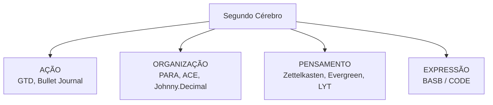

> [!summary]
> MOC dos métodos de **segundo cérebro**: o livro *Building a Second Brain* e os padrões que aparecem junto com ele (PARA, GTD, LYT, Evergreen Notes, Johnny.Decimal, Bullet Journal, Notion), cada um na sua pasta com teoria, formato correto, exemplos e erros comuns. Termina com a **escolha** do melhor setup para este vault. O manual do Zettelkasten fica nas outras pastas deste vault: [[Zettelkasten Method]].

> [!info] Origem
> As pastas 01 a 06 foram copiadas do vault `SecondBrainObsidian` em 2026-11-02. A pasta 07 foi escrita para este vault.

## Mapa geral



## As pastas
| # | Pasta | O que tem | Comece por |
|---|---|---|---|
| — | **Zettelkasten** | O manual do método: fundamentos, tipos de nota, configuração, fluxo, estratégia e [[Exemplo Completo - Do Livro à Rede de Notas\|exemplos]] | [[Zettelkasten Method]] |
| 01 | **BASB (O Livro)** | O livro do Tiago Forte resumido, CODE, sumarização progressiva, pacotes intermediários | [[BASB]] |
| 02 | **PARA** | Projetos, Áreas, Recursos, Arquivo | [[PARA]] |
| 03 | **GTD** | David Allen: 5 etapas, listas, revisão semanal | [[GTD]] |
| 04 | **LYT e ACE** | Nick Milo: MOCs, Home, Atlas/Calendar/Efforts | [[LYT]] |
| 05 | **Outros Padrões** | Evergreen Notes, Johnny.Decimal, Bullet Journal, Notion | [[Outros Padrões]] |
| 06 | **Escolha** | Comparativo, árvore de decisão, **setup recomendado**, rotina, migração | [[Escolha - Melhor Padrão]] |
| 07 | **Guia Passo a Passo** | Como usar cada método na prática, plano de 30 dias e trilha de experimentos | [[Guia Passo a Passo]] |

## A resposta curta
> [!tip] Qual seguir?
> **PARA** (pastas) + **Zettelkasten** (ideias) + **GTD-leve** (tarefas) + **Sumarização Progressiva** (livros), com **uma revisão semanal integrada**. Justificativa em [[Setup Recomendado - O Híbrido PARA + Zettelkasten + GTD]].

## Por onde começar, na prática
1. Ler [[O que é Building a Second Brain]] e [[Resumo do Livro Capítulo a Capítulo]] (20 min).
2. Ler [[Comparativo Completo dos Métodos]] e [[Setup Recomendado - O Híbrido PARA + Zettelkasten + GTD]].
3. Seguir o [[Guia Passo a Passo]], começando por [[Melhorar o Zettelkasten - Plano de 30 Dias]].
4. Escrever seus [[Os 12 Problemas Favoritos]].

## Templates (`Templates/`)
- `Second Brain - Projeto.md`
- `Second Brain - Área.md`
- `Second Brain - Revisão Semanal.md`

## Índices das pastas (auto-gerado)
```dataview
LIST
FROM "Segundo Cérebro"
WHERE any(map(file.tags, (t) => endswith(t, "/Index"))) AND file.name != this.file.name
SORT file.folder ASC
```
